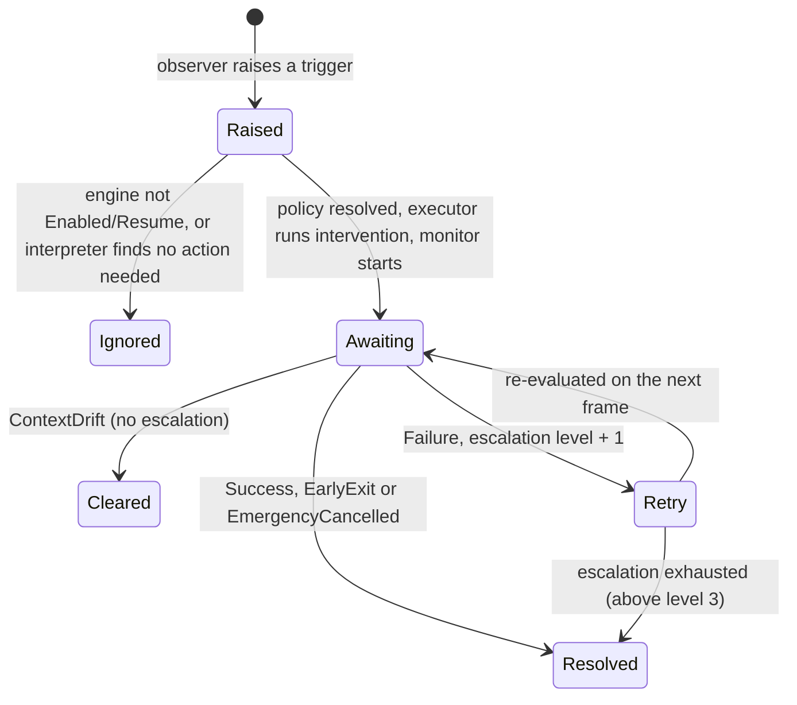

# Real-time behavioral monitoring and intervention (Unity XR)

Selected C# subsystems from a larger Unity XR research application. A participant works through a task in VR while the system watches their behavior (where they look, where they stand, how long they take) and, when a defined condition occurs, responds with an escalating series of prompts. This repository contains two of those subsystems:

- **Gaze tracking:** turns noisy eye/head sensor data into stable "looked at / stopped looking at" events.
- **Intervention engine:** a rule-based engine that detects conditions, decides on a response, carries it out, and checks whether the condition cleared.

<!-- TODO: one sentence on your role, e.g. "I designed and implemented both subsystems." -->

**The engine is rule-based. No trained model selects interventions.** The rules were designed with input from field experts (an occupational therapist, a psychologist and a caregiver), as an exploratory, context-aware system. Outcome monitors report whether an intervention's *immediate* condition was resolved. They do not establish that an intervention caused the change, and they say nothing about clinical or educational effectiveness.

## About this excerpt

This is a curated excerpt from a larger private application, meant to be **read, not built**. It will not compile or run on its own: it depends on scene components, types, audio and avatar services, and a data logger that are not included. No Unity compilation or headset execution is claimed for this extracted package.

**Suggested reading order (about ten minutes):** the scenario table and lifecycle diagram below, then `InterventionManager.cs` (state and escalation), `IntervenionPolicyResolver.cs` (the rules), `TimeInterventionMonitor.cs` (outcome checking), and `GazeInteractionTracker.cs` with `DebouncedValue.cs` (event filtering).

## How it works

```text
Eye / head tracking ──> Spatial queries ──> Stable gaze events ─────┐
                                                                    │
Movement / timing / task state ───────> Player observer ────────────┤
                                                                    ▼
                                                           Trigger interpreter
                                                                    │
                                                                    ▼
                                              Intervention manager / policy resolver
                                                                    │
                                                                    ▼
                                                        Intervention executor
                                                        ├─ Spoken prompts
                                                        ├─ Visual guidance
                                                        └─ Task retraining flow
                                                                    │
                                                                    ▼
                                                          Outcome monitors
                                                                    │
                                                  Resolve / clear / retry / escalate
```

The gaze components are one source of session information. The other behavior and task-state providers belong to the larger application and are not included.

### Scenario lifecycle



Each scenario type has at most one live state at a time, keyed by type. While a scenario awaits its outcome, new triggers of the same type are ignored.

### Scenario types

| Scenario | Trigger source | Interpreter check | Policy | Outcome monitor |
| --- | --- | --- | --- | --- |
| `DidNotMoveInTime` | Time | Still within the time limit? | Verbal, then visual ladder | Time |
| `NotOptimalPositionForTooLong` | Spatial | Out of zone past the limit, by turn status and position? | Context- and position-specific ladder | Spatial |
| `Missed_2_Or_3_PortalsThisRound` | Gaze (round summaries) | Always escalates | Verbal reminder to scan all portals | Gaze |
| `Missed_2_Or_3_Portals_For_2_Round` | Gaze (round summaries) | Always escalates | Gaze retraining | Gaze |
| `UnreasonableDecisions` | none in this version | Branch exists | none in this version | none in this version |

`UnreasonableDecisions` is declared and has an interpreter branch, but nothing raises it and it has no policy or monitor here. Treat it as reserved.

### Escalation ladder (example: `DidNotMoveInTime`)

| Level | Response |
| --- | --- |
| 0 | Verbal: repeat the instruction |
| 1 | Verbal: repeat it using the participant's name |
| 2 | Visual (system): draw a path to the selection area |
| 3 | Visual (avatar): the avatar demonstrates making the selection |

The position scenario follows the same shape (verbal cue, verbal cue with name, drawn path, avatar demonstration) but chooses the wording and target from the **task context** (listening, waiting for selection, returning to base, free exploration) and the participant's **spatial state** (in or out of the zone, facing or not facing the portals). If no rule matches, it falls through to movement retraining. The manager stops escalating after level 3.

### Outcome monitors

| Monitor | Question it answers | Window |
| --- | --- | --- |
| Time | Did the participant respond (make a choice or end the turn)? Time spent out of position does not count; the clock restarts once they are back. | 12 s, plus 4 s for verbal prompts |
| Spatial | After a fixed wait, is the participant now where the prompt asked? If the task context changed meanwhile, report `ContextDrift` instead of judging. | 10 s |
| Gaze | For gaze retraining: did the participant look at all portals in time? Verbal reminders count as complete after a fixed delay. | 150 s retraining, 6 s verbal |

### Key parameters

| Parameter | Default | Where |
| --- | --- | --- |
| Eye-tracking confidence needed to use eye gaze | 0.6 | `GazeManager` |
| Debounce (consecutive frames) for portal, avatar and blocking state | 3 | `GazeInteractionTracker` |
| Maximum gaze ray distance | 7 m | `RaycastUtils` |
| Response time before a time trigger | 10 s | `EIPlayerObserver` |
| Time out of the optimal zone before a spatial trigger | 5 s | `EIPlayerObserver` |
| Maximum escalation level | 3 | `InterventionManager` |

## Design decisions

- **Rules are separate from execution.** The resolver decides *what* to request; the executor decides *how* to perform it with the application's audio, visual and retraining services. Detection (observer), judgment (interpreter) and policy (resolver) are three separate steps, so each can be changed or tested on its own.
- **A sensor switch is a boundary.** When gaze moves between eye and head tracking, open look intervals are closed and pending samples are discarded, so one gaze duration never spans two sensors.
- **Debouncing cancels on return.** A different target must appear in consecutive samples before it counts, and a return to the confirmed target cancels the pending change.
- **Source selection polls.** The SDK integration has no reliable availability event, so the source is re-evaluated each frame and a change notification is published only on transitions.
- **Stale or duplicate outcomes are ignored.** The manager accepts an outcome only for the live state object that is still awaiting one, so a canceled or repeated report cannot resolve the wrong scenario.
- **Retries are deferred one frame,** so a retry never starts from inside an outcome callback.
- **The Time monitor judges fairly.** It suspends its clock while the participant is misaligned, instead of failing them for a problem the prompt was not about.

## Safety and oversight

The engine acts only when its status is `Enabled` or `Resume` (the admission rule is unit-tested). It can be paused, resumed or disabled through the control layer, and **emergency cancel** stops active interventions and their monitors and clears pending scenarios. In the full application a researcher dashboard issues these commands remotely. Escalation is capped, and a scenario whose context changes is cleared instead of escalated.

## Verification status

- **Unit tests (EditMode, NUnit):** `DebouncedValue` (five cases), the engine-state admission rule (four states), and three resolver branches (a first timeout, repeated missed portals, one round of missed portals). I checked these against the code by reading them. They have **not been run** here, and no assembly definition is included.
- **Not covered by tests:** the observer, interpreter, manager state machine, monitors and executor. These depend on scene state and timing and would need play-mode or integration tests.

## Known limitations

- Source selection has no hysteresis: eye confidence hovering around the threshold can switch sources repeatedly, and each switch closes the current look interval.
- Debounce thresholds are counted in frames, so behavior depends on the update rate.
- Gaze verbal reminders are marked successful after a fixed delay. That is a placeholder, not behavioral evidence.
- Outcome windows are fixed values in the source. The code notes making them configurable remotely as future work.
- In the Editor, the Time monitor reports `EarlyExit` instead of `Failure` when nobody responds, to avoid escalation loops while testing without a participant.
- Scenario types are tracked independently but share services (audio, avatar, visuals). Concurrent execution needs integration testing.

## Dependencies

Unity, the Meta XR SDK (`OVRPlugin`, `OVREyeGaze`), Odin Inspector (editor buttons, in two files), and NUnit for the tests. Project-specific types and components that are **intentionally not included**: `Portal`, `PortalSlot`, `CentralEventSystem`, `IELogger`, `PlayerTurnStatus`, `PlayerSpatialState`, `ZoneType`, `SpawnedPortalData`, `ElevenLabsTTSRuntime`, `ParticipantNameTTSManager`, `AvatarInterventionHandler`, `VisualEffectsManager`, `GazeInterventionHandler`, `GameStartManager`, `TurnManager` and `StoryContextManager`. The data logger, participant data and scene assets are also not included.

## Contents

- [`GazeTracking/`](GazeTracking): sensor sources, raycasting, debounced interaction events and a debug visualizer. See its README.
- [`InterventionEngine/`](InterventionEngine): observer, interpreter, manager, resolver, executor and outcome monitors. See its README.
- [`Tests/EditMode/`](Tests/EditMode): NUnit tests for the debouncer, engine admission and representative policy branches.

## License

