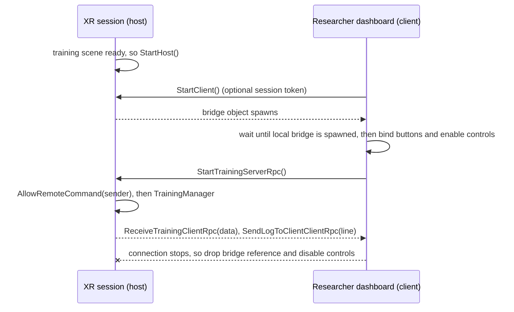

# Remote Session Control and Telemetry (Unity Netcode)

A networking subsystem from a Unity-based XR research application. The XR session runs as the **host**; a separate Unity **researcher dashboard** connects as a client. From the dashboard a researcher can start parts of the session, change selected settings, and watch state and runtime logs, all without interrupting the participant inside the headset.


## About this excerpt

This is a **source excerpt from a larger private application**. It is meant to be read, not built:

- The surrounding managers, scenes, prefabs and serializable payload types are not included, so the folder will not compile or run on its own.
- The original subsystem is part of a working application. The version in this folder was edited for clarity and robustness (see [CHANGELOG.md](CHANGELOG.md)) and **was not compiled or executed after those edits**. Treat it as reviewed source, not tested source. The changes that alter behavior need integration testing against the full project (see [How I would verify it](#how-i-would-verify-it)).

**Suggested reading order (about five minutes):** the RPC table below, then `NetworkSharedLogic.cs` (the bridge), then `ResearcherToolUI.cs` (how the dashboard binds to it), then `ConsoleToHost_And_ClientUILogger.cs` (log forwarding).

## Architecture

```text
Researcher dashboard (client)                   XR session (host/server)
┌─────────────────────────────┐                 ┌────────────────────────────┐
│ ResearcherToolUI            │                 │ GameStartManager           │
│ NetworkSharedLogic          │ -- ServerRpc -->│ TrainingManager            │
│ ResearcherLogUI             │                 │ InterventionManager        │
│ ResearcherToolUIManager*    │<-- ClientRpc -- │ GazeManager / log producer │
└─────────────────────────────┘                 └────────────────────────────┘
               * Not included in this excerpt
```

The host accepts dashboard commands over Netcode RPCs and sends back status snapshots, portal events, training updates, participant lists and runtime log lines. The bridge delegates all business logic to existing application managers; it does not implement training, gaze tracking or intervention policy itself.

### Connection and binding lifecycle



The dashboard cannot bind its callbacks until the network object has spawned, which can happen after the client-connected callback. Binding therefore waits for the bridge instead of assuming it exists.

## RPC reference

**Dashboard to host** (all pass through `AllowRemoteCommand`, which checks that the sender is a connected client and, optionally, a configured client ID):

| RPC | Payload | Effect on host |
| --- | --- | --- |
| `StartTrainingServerRpc` | none | Starts the training phase. |
| `SelectStoryServerRpc` | `int storyIndex` (>= 0) | Selects a story in the host UI. |
| `LoadSelectedStoryServerRpc` | none | Loads the selected story. |
| `StartGameServerRpc` | none | Starts the story session. |
| `SetParticipantServerRpc` | `string name` | Sets the current participant. Rejected if empty, over 64 characters, or containing `\| / \ : * ? " < >` or control characters. |
| `RequestParticipantListServerRpc` | `ulong clientId` | Replies with the cached participant names, **to the requester only**. `clientId` must equal the actual sender. |
| `SetVoiceServerRpc` | `bool isFemale` | Selects the TTS voice. |
| `StartDataLoggingServerRpc` | none | Starts data recording (recording itself lives elsewhere). |
| `SetInterventionEngineStateServerRpc` | `InterventionEngineStatus` | Changes the intervention engine state. |
| `CancelAllInterventionsServerRpc` | none | Emergency-cancels active interventions. |
| `ReCheckEyeTrackingServerRpc` | none | Re-runs the eye-tracking check. |
| `StartEyeAndHeadVisualizationServerRpc`, `StartEyeVisualizationServerRpc`, `StartHeadVisualizationServerRpc`, `StopGazeVisualizationServerRpc` | none | Controls gaze visualization. |
| `RequestServerToDisconnectMeServerRpc` | none | Disconnects the **caller only**, never a caller-supplied ID. |

**Host to dashboard:**

| RPC | Payload | Delivery |
| --- | --- | --- |
| `SendParticipantListClientRpc` | pipe-delimited names | Targeted to the requesting client. |
| `SendLogToClientClientRpc` | formatted log line | Broadcast to all dashboards; best-effort. |
| `ReceivePlayerStatusDataClientRpc` | `PlayerStatusData` | Broadcast. |
| `ReceiveTrainingClientRpc` | `TrainingStatusData` | Broadcast. |
| `ReceivePortalDataClientRpc` | `SpawnedPortalData` | Broadcast. |

## Files

| File | Responsibility |
| --- | --- |
| `NetworkSharedLogic.cs` | Network-spawned RPC bridge. Resolves scene managers, admits and validates commands, routes requests and responses. |
| `NetworkStartScript.cs` | Starts the host after a session-ready event; optional listen-address and session-token settings. |
| `ConnectionNotificationManager.cs` | Publishes connect/disconnect notifications from Netcode as one event. |
| `ConsoleToHost_And_ClientUILogger.cs` | Bounded on-screen console history; forwards messages to dashboards through a rate-limited queue. |
| `ResearcherToolUI.cs` | Connects dashboard controls to the bridge once it has spawned. |
| `ResearcherLogUI.cs` | Renders the received log stream with a size cap. |
| `SceneLookup.cs` | Small helper so scene lookups work before and after Unity 2023.1. |

## Dependencies

- Unity with Netcode for GameObjects and Unity Transport, written against the project's `ServerRpc`/`ClientRpc` API. <!-- TODO: add exact Unity and Netcode for GameObjects versions. -->
- TextMeshPro and Unity UI.
- A `NetworkManager` with a `UnityTransport` component, and a spawned object tagged `NetworkPlayerPrefab` that carries `NetworkSharedLogic`.
- Application classes and serializable payloads that are **intentionally not included**: `GameStartManager`, `TrainingManager`, `InterventionManager`, `GazeManager`, `ParticipantNameTTSManager`, `ElevenLabsTTSRuntime`, `RemoteLoggingController`, `IEEventSystem`, `CentralEventSystem`, `ResearcherToolUIManager`, `ResearcherClientLogManagement`, `PlayerStatusData`, `TrainingStatusData`, `SpawnedPortalData`, `InterventionEngineStatus`.

## Design notes

**Roles.** The XR session owns application state. The dashboard requests actions and never changes state authoritatively on its own side. Status and logs flow the other way. The design assumes one host and one or a few researcher clients.

**Why `RequireOwnership = false`.** The dashboard may call an object that the host owns, so ownership cannot be the gate. Authorization is explicit instead: `AllowRemoteCommand` checks the real RPC sender. The dashboard also prefers the bridge on its own player object, with the tagged object as a fallback, so it does not bind to another client's copy.

**Command admission.** Three layers, all opt-in beyond the first: (1) the sender must be a connected client; (2) commands can be restricted to one configured client ID; (3) the host can require a shared session token through Netcode connection approval. **None of this is encryption or identity verification.** A client ID is not authentication, and the token travels over an unencrypted transport, so it keeps out accidental or casual peers and nothing more. Run on a trusted research network. The host listens on `0.0.0.0` by default; set `listenAddress` to narrow it. If a token is required but not configured correctly, the host refuses to start instead of running open.

**Privacy of participant data.** The participant list is sent only to the client that asked for it. Participant names are validated on entry because they reach text-to-speech and may reach file names elsewhere. Log lines, however, go to every connected dashboard and can contain whatever the application logs, so they are part of the trust boundary.

**Log forwarding.** Recent logs are shown locally and forwarded while at least one non-host client is connected. Forwarding is diagnostic telemetry, not guaranteed delivery. Lines go into a bounded queue (oldest dropped first, with a notice), are sent at a capped rate per frame, and are rebuilt into the on-screen text once per frame, which matters on a headset. Messages logged during a send are shown locally but not re-forwarded, so a failing send cannot feed itself.

**Network lifecycle.** Connection handlers subscribe and unsubscribe with their component lifetime. When the client stops, the dashboard drops its bridge reference and disables its controls. Host startup waits for the event system if it is not ready yet and ignores repeated readiness events.

## Known limitations

- No encryption, identity verification or role-based authorization; see Command admission.
- The participant list is pipe-delimited for compatibility with the existing dashboard. Names containing `|` are now rejected on entry, but names cached earlier are not migrated. A structured payload would be the proper fix.
- Commands are forwarded to the managers without checking session state (for example, starting a session twice). Those checks belong to the managers and are not part of this excerpt.
- `ConnectionNotificationManager` and the log forwarder both subscribe to the same Netcode callbacks. Consolidating them would be a cleanup.
- Some method names on the (excluded) dashboard manager keep their original spelling (`...Reciever`) so existing callers keep working.
- Reconnect and retry logic is not implemented; the dashboard rebinds when the client is started again.


